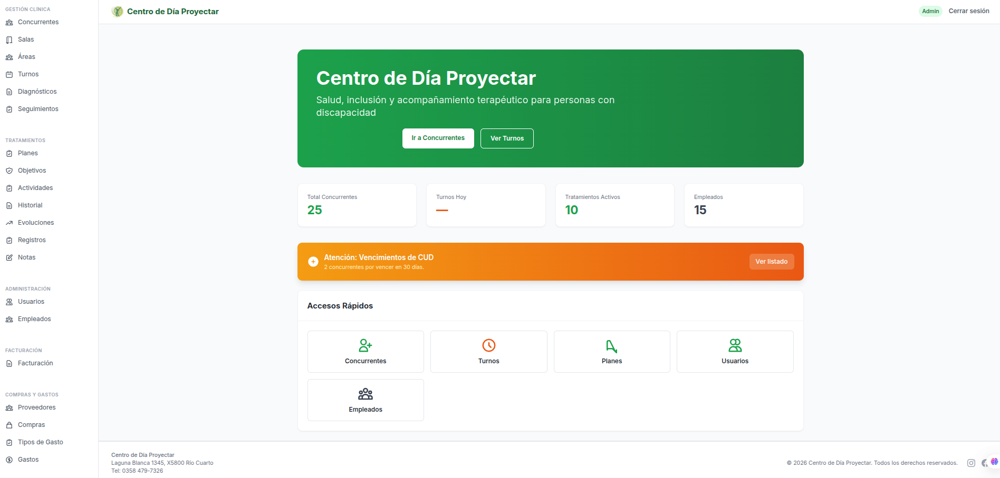
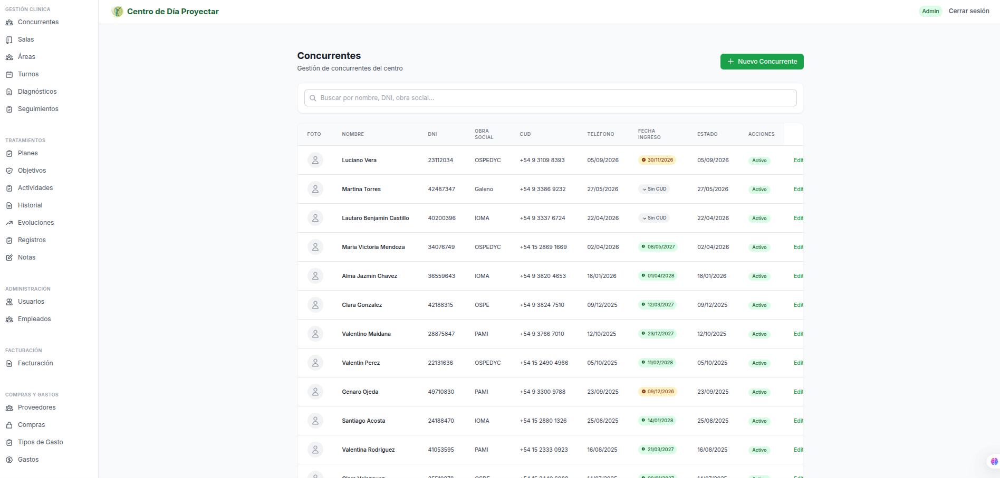
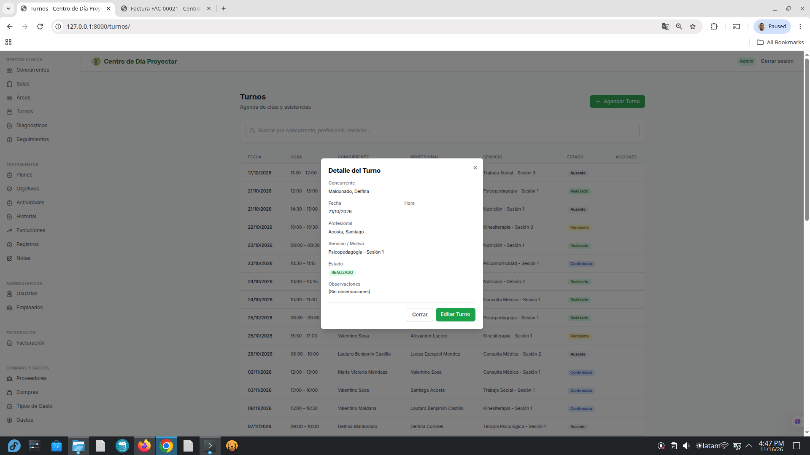

# Centro de Día Proyectar - Sistema de Gestión Integral

[](https://www.djangoproject.com/)
[](https://www.python.org/)
[](https://www.docker.com/)
[](https://supabase.com/)
[](https://github.com/)

> 🚀 **Proyecto en vivo:** [https://centro-proyectar.onrender.com](https://centro-proyectar.onrender.com)

Sistema **Full-Stack (Django MVT + API REST)** para la gestión integral del Centro de Día Proyectar: pacientes, turnos, profesionales, facturación, inventario, compras y documentación clínica.

---

## Stack Tecnológico

| Capa | Tecnología |
|------|------------|
| **Backend** | Django 6.1, Django REST Framework 3.18 |
| **Base de datos** | PostgreSQL (Supabase) / SQLite (desarrollo) |
| **Autenticación** | JWT (SimpleJWT) + Session Auth (MVT) |
| **Frontend (MVT)** | Templates Django + TailwindCSS (CDN) + HTMX/Alpine.js |
| **Documentación API** | drf-spectacular (OpenAPI/Swagger) |
| **Static Files** | WhiteNoise |
| **Servidor WSGI** | Gunicorn |
| **Contenedores** | Docker + Docker Compose |
| **Storage** | Supabase Storage (S3 compatible) / FileSystem (local) |
| **Tests** | pytest + model-bakery |
| **Gestor de paquetes** | uv |

---

## Características Principales

- **Sistema cerrado**: Solo administradores crean usuarios; no hay registro público.
- **Roles con dashboards personalizados**:
  - **Admin**: Acceso total, gestión de usuarios/roles, configuración.
  - **Recepcionista**: Turnos, pacientes, salas, agenda diaria, check-in.
  - **Orientador**: Pacientes asignados, seguimientos, derivaciones, legajos.
  - **Profesionales (Médico, Psicólogo, etc.)**: Solo sus pacientes/áreas, evolución, tratamientos, agenda propia.
- **CRUDs HTML completos** con validaciones:
  - Pacientes (alertas CUD: Crear/Actualizar/Eliminar con confirmaciones).
  - Turnos (validación de solapamiento, modal de agendamiento rápido).
  - Salas, Áreas, Diagnósticos, Seguimientos.
- **Live Search** (búsqueda en vivo) en todos los listados.
- **Impresión A4 optimizada** con `@media print`: Legajo del paciente y Facturas (thead/tfoot repetidos, márgenes 1.5cm).
- **Gestión de compras, inventario y facturación** integrada (proveedores, stock, facturas, pagos, movimientos).
- **Storage en Supabase (S3)** para documentos clínicos y adjuntos; filesystem local en desarrollo.

---

## Instalación Local

```bash
# 1. Clonar y entrar
git clone https://github.com/Maxi-Lopez/Practica_Profesionalizante_II_Lopez.git
cd centro_salud_api

# 2. Instalar dependencias con uv
uv sync

# 3. Configurar entorno
cp .env.example .env
# Editar .env con tus valores (SECRET_KEY, DATABASE_URL, etc.)

# 4. Base de datos y superusuario
uv run python manage.py migrate
uv run python manage.py createsuperuser

# 5. Ejecutar servidor de desarrollo
uv run python manage.py runserver
```

**Con Docker (opcional):**
```bash
docker compose up --build
# Servidor en http://localhost:8000
```

---

## Roles y Accesos (Resumen para Docentes)

| Rol | Dashboard | Acceso Principal | Filtros / Restricciones |
|-----|-----------|------------------|-------------------------|
| **Admin** | Completo | Usuarios, Roles, Config, Todo | Sin restricciones |
| **Recepcionista** | Agenda diaria, Turnos | Pacientes, Turnos, Salas, Check-in | Ve todos los turnos del día |
| **Orientador** | Pacientes asignados | Seguimientos, Derivaciones, Legajos | Solo sus pacientes asignados |
| **Profesional** | Mi agenda / Mis pacientes | Evoluciones, Tratamientos, Turnos propios | Solo su área/especialidad y pacientes vinculados |

> Cada rol tiene su `base.html` y `dashboard.html` con menú lateral contextual y querysets filtrados en `get_queryset()` de las CBVs.

---

## Documentación API

- **Swagger UI**: `/api/schema/swagger/`
- **OpenAPI JSON**: `/api/schema/`
- **Redoc**: `/api/schema/redoc/`

> El foco del proyecto es **MVT (Server-Side Rendering)**; la API expone endpoints para integraciones futuras y móvil.

---

## Metodología (Prácticas Profesionalizantes II)

- **GitFlow**: Rama `main` (producción), `develop` (integración), `feature/*`, `hotfix/*`, `release/*`.
- **Pull Requests** obligatorios con revisión de código; no commits directos a `main`/`develop`.
- **Commits semánticos** (Conventional Commits): `feat:`, `fix:`, `refactor:`, `docs:`, `test:`, `chore:`.
- **Kanban** en GitHub Projects: Backlog → Ready → In Progress → Review → Done; WIP limits por columna.

---

## Deploy (Resumen Ejecutivo)

**Plataforma**: Render (Web Service Docker) + Supabase (PostgreSQL + Storage).

1. **Supabase**: Crear proyecto → obtener `DATABASE_URL` (Connection Pooling, puerto 6543) → crear bucket `documentos` (privado) → generar S3 Keys.
2. **Render**: New → Blueprint (`render.yaml`) → conectar repo → configurar variables secretas (ver `.env.example`).
3. **Variables clave en Render**:
   - `DJANGO_SETTINGS_MODULE=config.settings.production`
   - `DEBUG=False`
   - `SECRET_KEY`, `ALLOWED_HOSTS`, `CSRF_TRUSTED_ORIGINS`
   - `DATABASE_URL` (Supabase pooling)
   - `USE_SUPABASE_STORAGE=True` + credenciales S3
4. **Build automático**: `collectstatic` → `migrate` → `gunicorn` (3 workers).
5. **Verificación**: Health check `/health/`, Swagger `/api/schema/swagger/`, Admin `/admin/`.

> Detalle completo de variables en [`.env.example`](.env.example).

---

## Tests

```bash
uv run pytest -q
```

---

## Licencia

Proyecto académico - Prácticas Profesionalizantes II

---

## Capturas del Sistema

### Dashboard Administrativo


### Gestión de Concurrentes (con alerta CUD)


### Agenda de Turnos y Modal de Agendamiento


### Legajo Clínico Imprimible (PDF)
